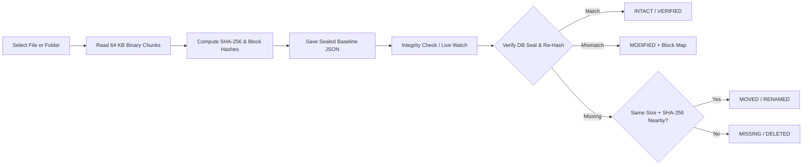

# Integrity Monitor

A cryptographic **File Integrity Monitoring (FIM)** tool written in pure Python using the standard `hashlib` and `os` libraries. It detects unauthorized or unexpected file changes by recording reference **SHA-256** digests and comparing them against freshly computed hashes whenever files are verified.

---

## Overview

When a file is registered for monitoring, the tool reads its raw bytes in chunks, computes a **256-bit SHA-256 reference hash**, and stores it in a local baseline database. On subsequent checks, a fresh SHA-256 digest is generated and compared against the stored baseline to determine whether the file is **Intact**, **Modified**, **Renamed**, or **Missing**.

Zero third-party packages are required—anyone cloning this repository can run the interactive CLI, the automated attack-simulation demo, the unit tests, or the local browser dashboard directly with standard Python 3.10+.

---

## Beyond Basic Hash Comparison

While building the core SHA-256 check, I noticed a few practical limitations in simple hash-comparison scripts and added four lightweight ideas using `hashlib` and `os`:

1. **Block-Level Tamper Localization (`B01:ok  B02:DIFF` / `B03:+NEW`)**
   Due to the cryptographic *avalanche effect*, flipping even a single character completely changes a file's 64-character SHA-256 hash. That proves tampering happened, but doesn't tell you *where* or *how* the file changed. Alongside the full-file SHA-256, this tool splits the file into up to 16 fixed-size byte blocks and stores short block digests. Without saving a plaintext backup copy of potentially sensitive files, it can distinguish:
   - In-place edits within a specific byte range (`B01:ok  B02:DIFF  B03:ok`)
   - Data appended to the end of logs or CSVs while original bytes remain untouched (`B01:ok  B02:ok  B03:+NEW`)
   - File truncation (`B01:ok  B02:CUT`)

2. **Tamper-Evident Baseline Seal ("Guarding the Baseline")**
   If stored hashes live in a plain JSON file (`baseline.json`), someone who modifies a monitored file could also open `baseline.json` and paste in the new hash to hide the edit. To prevent this, baseline entries are signed with a keyed SHA-256 seal (`core/seal.py` using `os.urandom` + `hashlib.sha256`). Any manual edit to `baseline.json` triggers a `BASELINE SEAL BROKEN` warning.

3. **Distinguishing Renamed Files from Deleted Files**
   When `os.path.exists()` reports a monitored path is missing, the monitor scans the parent directory (`os.listdir`), pre-filters untracked files by matching byte count (`os.path.getsize`) so large unrelated files are skipped quickly, and checks `SHA-256`. If an identical digest is found, it reports `MOVED / RENAMED` with the new filename instead of a false deletion alarm.

4. **Dual Interface: Terminal CLI + Local Inspection Workbench**
   Works both from an interactive terminal menu (with native OS file-picker dialog support) and from a clean split-pane localhost **File Integrity Workbench** (`http://127.0.0.1:8765`) featuring 8-word grouped SHA-256 nibble diffing, a numbered byte-offset block matrix, a summary ledger table, and 3-second Auto-Poll verification.

---

## How It Works



---

## Project Structure

```text
integrity-monitor/
├── main.py                 # Entry point: interactive menu + CLI subcommands
├── demo_sandbox.py         # Automated sandbox demo simulating 5 tamper scenarios
├── core/
│   ├── hasher.py           # Streaming SHA-256, OS metadata, and block-map comparison
│   ├── monitor.py          # Baseline lifecycle, integrity checks, rename detection & audit log
│   └── seal.py             # Keyed SHA-256 seal protecting baseline.json from manual edits
├── ui/
│   ├── cli_display.py      # Terminal cards, status badges, block bars & native file picker
│   └── dashboard.py        # Local web dashboard server (built-in http.server)
├── web/
│   ├── index.html          # Split-pane Inspection Workbench, Ledger & Audit views
│   ├── style.css           # Drafting-paper & Prussian-blue workbench styles
│   └── app.js              # 8-word SHA-256 nibble diff, block matrix & Auto-Poll state
└── tests/
    └── test_monitor.py     # Unit tests (built-in unittest)
```

---

## Getting Started

### Prerequisites
- **Python 3.10 or newer** (uses only the Python Standard Library—no `pip install` needed).

```bash
git clone https://github.com/tokaushik/integrity-monitor.git
cd integrity-monitor
```

### 1. Run the Interactive Terminal Menu
```bash
python main.py
```
From the menu, you can select files using a native File Explorer dialog, pick from files in your current directory, run single or full scans, accept authorized changes (re-baseline), start Live Watch mode, or open the web dashboard.

### 2. Run the 15-Second Automated Demo
Want to see every status (`INTACT`, `MODIFIED`, `APPENDED`, `RENAMED`, `MISSING`, and `BASELINE SEAL BROKEN`) in action right away inside a temporary sandbox folder?
```bash
python main.py demo
```

### 3. Launch the Local Browser Workbench
```bash
python main.py ui
```
Opens `http://127.0.0.1:8765` in your browser as a split-pane **Inspection Sheet**—click **Select File...** to record a baseline, compare stored vs. current SHA-256 digests split into eight 32-bit hex words (`W0`–`W7`) with character-level diff highlights, inspect exact byte ranges in the **Block Matrix**, and toggle **Auto-Poll (3s)** while editing a file live.

### 4. Direct Command-Line Subcommands
```bash
# Select a file and generate its reference SHA-256 baseline
python main.py add path/to/config.ini

# Re-hash and check a specific file (or omit path to check all tracked files)
python main.py check path/to/config.ini
python main.py check

# Continuously watch tracked files for real-time modifications
python main.py watch --interval 2

# Update stored reference hash after making an intentional, authorized edit
python main.py rebaseline path/to/config.ini

# View monitored files or audit history
python main.py list
python main.py history

# Stop monitoring a file
python main.py remove path/to/config.ini
```

---

## Sample Terminal Output

```text
----------------------------------------------------------------------------
  File         : server_config.ini   [ ALERT : HASH MISMATCH ]
  Location     : C:\Projects\integrity-monitor\sample_files\server_config.ini
  Stored Hash  : 1b0802f1 c0bfca22 108a6d5b cd70e6f1 6d29aeaf 1db9bd5c 5c87556f fb962ca0
  Current Hash : 039f7832 27204fe9 9f06f648 d5d09c3f a4653abb e800d338 dbbd3297 bad83774
  Byte Size    : 248 B -> 248 B (no size change)
  Timestamp    : 2026-10-30 20:58:12
  Block Matrix : B01:ok  B02:DIFF  B03:ok  B04:ok  (~64 B/block)
  Finding      : Tampering detected across 1 block(s); first divergence in Block 2 (bytes 64-128)
----------------------------------------------------------------------------

----------------------------------------------------------------------------
  File         : club_treasury.csv   [ ALERT : HASH MISMATCH ]
  Location     : C:\Projects\integrity-monitor\sample_files\club_treasury.csv
  Stored Hash  : 533ebccb 32b3f3f0 b70ae1b6 47cda461 02044cb5 73a689d0 214aea8a 34325b42
  Current Hash : cdeeb4f3 53ac10e0 17c4e162 fba911e5 1aa68348 77359a18 77cf8023 05a05262
  Byte Size    : 128 B -> 155 B (+27 B)
  Timestamp    : 2026-10-30 20:58:12
  Block Matrix : B01:ok  B02:ok  B03:+NEW  (~64 B/block)
  Finding      : Original blocks intact; new data appended at end (+27 bytes)
----------------------------------------------------------------------------
```

---

## Running Tests

The test suite uses Python's built-in `unittest` framework and verifies NIST SHA-256 test vectors, multi-chunk streaming on large binaries, block-map localization, file rename detection, and baseline seal tamper detection:

```bash
python -m unittest discover -s tests -v
```
